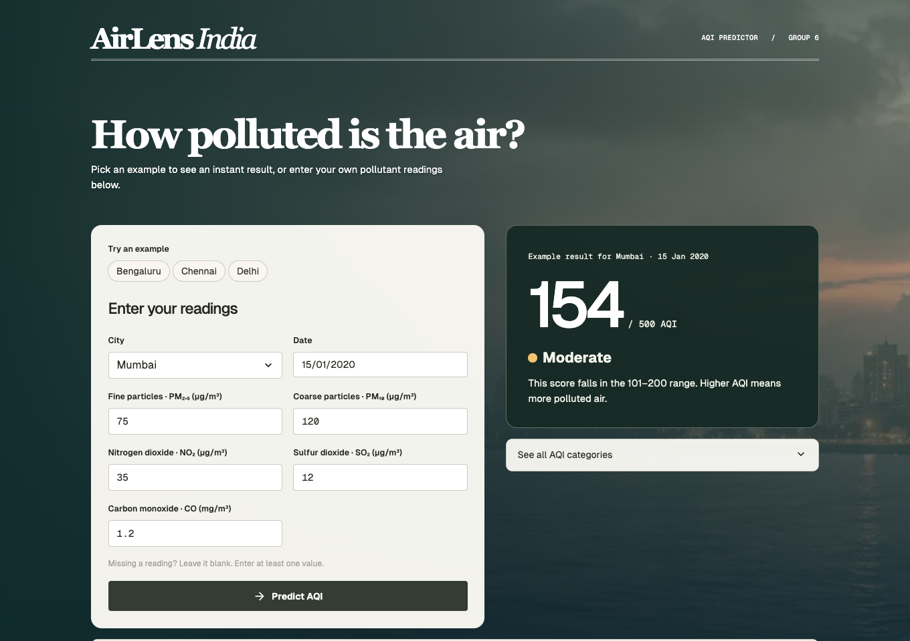
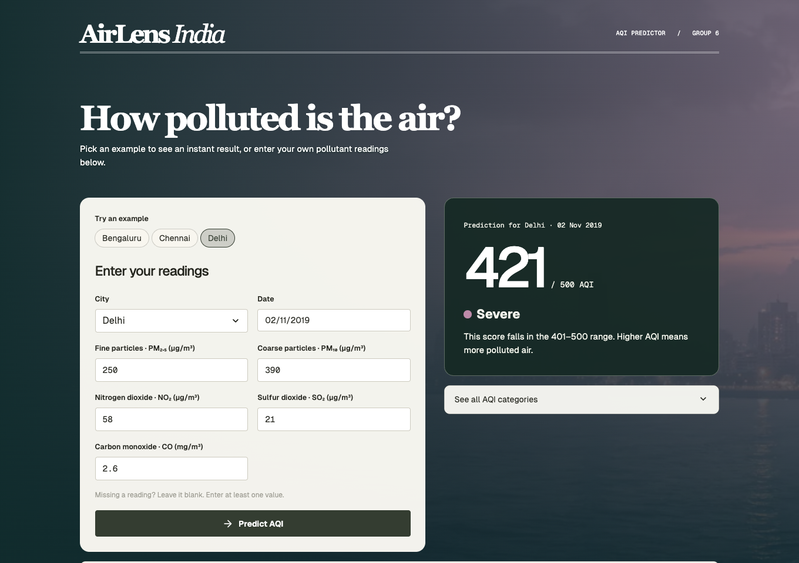
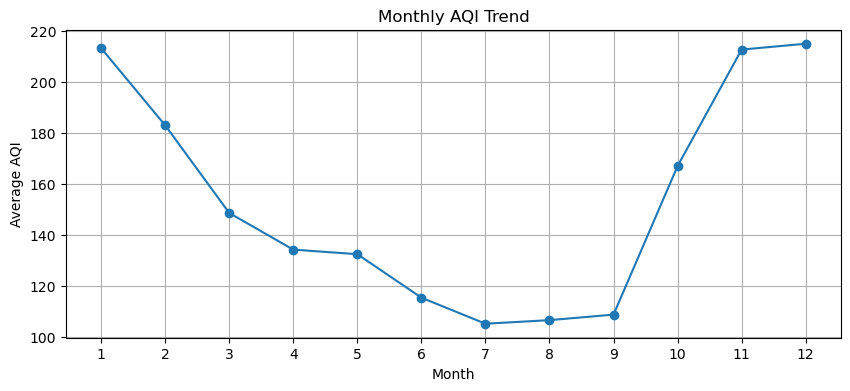
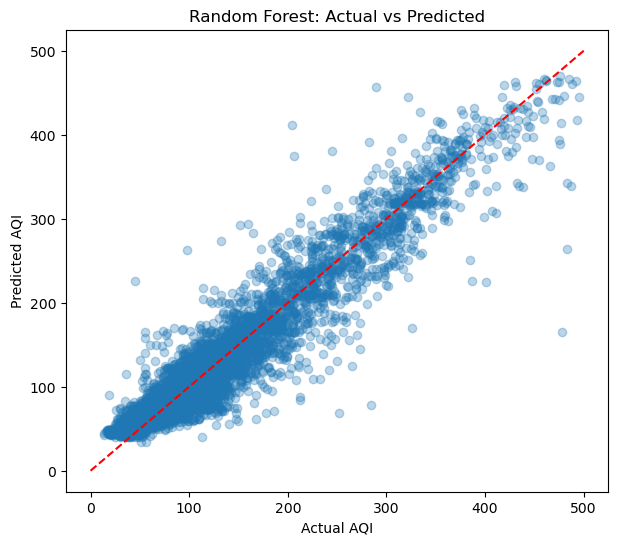

# AirLens India

Estimate a city's daily Air Quality Index (AQI) from five pollutant readings. AirLens India pairs a prediction with the Indian AQI category, then lets you look back at recorded daily air quality for the same city.

**[Open the Streamlit app](https://airlens-india.streamlit.app/) · [Read the project report](docs/reports/Group%20Six.pdf) · [View slide PDF](docs/presentation/AirLens%20India%20-%20Group%20Six.pdf) · [Download PowerPoint](docs/presentation/AirLens%20India%20-%20Group%20Six.pptx)**



The opening example is Mumbai on 15 January 2020. The saved model gives **154, Moderate**. Across 6,912 held-out city-day records, its mean absolute error was **16.75 AQI points**. That average describes performance across the test set. An individual estimate can be further from the recorded value.

## Try a prediction

1. Choose **Bengaluru**, **Chennai**, or **Delhi** under **Try an example** to load readings and see an immediate result.
2. For your own estimate, select a city and date, enter at least one pollutant concentration, and select **Predict AQI**. Use µg/m³ for PM2.5, PM10, NO₂ and SO₂, and **mg/m³ for CO**. Blank fields use the saved model's medians.
3. Open **See all AQI categories** to place the result on the scale. Open **Explore historical readings** to see a calendar for the result city. Hover over a square for its date and recorded AQI. A blank day means the dataset has no AQI for that date.

These examples can also be entered by hand to check a local installation. They are sample inputs, not claims about what a monitoring station measured that day.

| City | Date | PM2.5 | PM10 | NO₂ | SO₂ | CO | App result |
| --- | --- | ---: | ---: | ---: | ---: | ---: | --- |
| Bengaluru | 15 Jul 2019 | 14 | 32 | 11 | 4 | 0.4 | 51 · Satisfactory |
| Chennai | 10 Dec 2019 | 58 | 106 | 26 | 9 | 0.8 | 114 · Moderate |
| Mumbai | 15 Jan 2020 | 75 | 120 | 35 | 12 | 1.2 | 154 · Moderate |
| Delhi | 2 Nov 2019 | 250 | 390 | 58 | 21 | 2.6 | 421 · Severe |



### Reading the result

| Displayed AQI | Category | Displayed AQI | Category |
| ---: | --- | ---: | --- |
| 0–50 | Good | 201–300 | Poor |
| 51–100 | Satisfactory | 301–400 | Very Poor |
| 101–200 | Moderate | 401–500 | Severe |

The app clips predictions to 0–500 and rounds to the nearest integer before assigning a category. The calendar uses recorded values from the CSV. If you enter a date beyond a city's records, the calendar ends in that city's last available month. A later date can be entered for a hypothetical prediction, but the app has no live sensor feed or weather forecast.

## Dataset and preparation

The project asks whether five concentrations, together with the city and the date, can estimate the daily AQI already recorded in historical data. Each row represents one city on one date. The target is the numeric **AQI** column. The category shown in the app is derived from the predicted score.

The [included city-day dataset](data/city_day.csv) contains **29,531 rows**, **16 columns** and **26 cities**, spanning **1 January 2015 to 1 July 2020**. The notebook found zero duplicate rows. It removed 4,681 rows without a target, then excluded 543 recorded AQIs above 500 to match the app's scale. That left **24,307 labelled rows**. [Dataset source on Kaggle](https://www.kaggle.com/datasets/rohanrao/air-quality-data-in-india)

| Model input | Missing in raw data | Missing after target filtering | Role |
| --- | ---: | ---: | --- |
| PM2.5 | 4,598 | 671 | Fine particulate matter |
| PM10 | 11,140 | 6,695 | Coarse and fine particulate matter up to 10 µm |
| NO₂ | 3,585 | 390 | Nitrogen dioxide |
| SO₂ | 3,854 | 597 | Sulfur dioxide |
| CO | 2,059 | 436 | Carbon monoxide |

**Missing concentrations.** Dropping every incomplete reading would discard thousands of usable AQI targets, especially where PM10 is absent. Each model learns a median for each numeric feature from its fitting data. The same fitted preprocessing runs when the app receives a blank reading.

**City and date.** One-hot encoding gives each city its own indicator, avoiding an artificial ranking of cities. The notebook extracts year, month, day of month and weekday from the date. Together with city and the five concentrations, these make ten input fields. The recorded category, AQI_Bucket, is excluded because it already describes the target.

## What the historical data shows

Across the retained observations, Ahmedabad averaged **291.7 AQI**, Delhi **252.1**, Mumbai **105.4** and Bengaluru **94.3**. The pooled monthly mean was **215.1 in December** and **105.1 in July**. Cities contribute different numbers of observations, so these averages describe the available records.



The [analysis notebook](AQI.ipynb) also includes the distribution of daily AQI, a city-by-month heatmap, city-level pollutant concentrations, yearly averages and pollutant correlations.

## Model evaluation

Both models use the same preprocessing. **Linear Regression** provides a baseline. The **Random Forest Regressor** uses 80 trees, a maximum depth of 12 and random seed 42. The notebook orders unique dates, then uses the earliest 70% for training, the next 15% for validation and the latest 15% for testing. All cities observed on a given day stay together. Daily coverage varies, so the row counts differ from those percentages.

| Split | Dates, inclusive | City-day records | Use |
| --- | --- | ---: | --- |
| Training | 1 Jan 2015 – 6 Nov 2018 | 12,122 | Fit both candidates |
| Validation | 7 Nov 2018 – 3 Sep 2019 | 5,273 | Choose the model with the lowest RMSE |
| Test | 4 Sep 2019 – 1 Jul 2020 | 6,912 | Compare both models after refitting on training and validation |

### All reported scores

| Split | Model | MAE ↓ | MSE ↓ | RMSE ↓ | R² ↑ |
| --- | --- | ---: | ---: | ---: | ---: |
| Validation | Linear Regression | 25.5540 | 1,465.4764 | 38.2815 | 0.8618 |
| Validation | Random Forest | 19.2383 | 948.1098 | 30.7914 | 0.9106 |
| Test | Linear Regression | 21.7566 | 962.2052 | 31.0194 | 0.8632 |
| Test | **Random Forest** | **16.7518** | **621.4131** | **24.9282** | **0.9117** |

MAE measures the average absolute miss in AQI points. MSE squares each error before averaging, giving larger misses more weight. RMSE takes the square root and returns to AQI points. R² compares the model's errors with the variation in the observed target.

Random Forest won on validation RMSE. On the later test dates it reduced the average absolute miss by **5.00 AQI points**, about **23%**, compared with Linear Regression. The notebook scores clipped, unrounded predictions. Once evaluation is complete, it fits the selected forest on all 24,307 rows and exports that final pipeline for Streamlit.



Each dot represents a held-out city-day. Dots below the diagonal are underestimates. The spread explains why two days with the same recorded AQI can yield different model errors. The reported scores apply to this historical holdout and the 0–500 target range. They do not measure performance on current conditions or on the 543 more extreme observations excluded from training.

## Project layout

```text
.
├── app.py                       Streamlit entry point
├── requirements.txt             Pinned app dependencies
├── .streamlit/config.toml       Theme and runtime settings
├── assets/                      Stylesheet, skyline and bundled fonts
├── data/city_day.csv            Daily observations
├── models/aqi_model.pkl         Fitted pipeline, feature order and cities
├── AQI.ipynb                    EDA, training, evaluation and export
└── docs/
    ├── images/                  App screenshots and notebook figures
    ├── presentation/            Seven-slide PowerPoint and PDF
    └── reports/                 Editable Word report and PDF
```

## Run locally

Use Python 3.13 and open a terminal in the directory containing this README.

```sh
python -m venv .venv
source .venv/bin/activate
python -m pip install -r requirements.txt
python -m streamlit run app.py
```

On Windows PowerShell, activate the environment with `.\.venv\Scripts\Activate.ps1`. Open the local URL printed by Streamlit. The saved model is included, so you can test the Mumbai example immediately.

### Reproduce the notebook

In the same environment, install the notebook and plotting tools, then launch Jupyter from the project root.

```sh
python -m pip install jupyterlab matplotlib seaborn
python -m jupyterlab AQI.ipynb
```

Select the project environment as the kernel and run the cells in order. The notebook reads `data/city_day.csv`. Its final cells refit the model, write `models/aqi_model.pkl` and reload it for the Mumbai example. Running those cells replaces the bundled model. To experiment while keeping the original artifact, run the notebook in a copy of the project.

### Streamlit Community Cloud

Use the repository root as shown above, select `app.py` as the entry point and choose Python 3.13. Include the model, CSV, assets, Streamlit config and requirements in the same deployment commit. The notebook and reports are available for review and are independent of app startup. [Community Cloud deployment guide](https://docs.streamlit.io/deploy/streamlit-community-cloud/deploy-your-app/deploy)

## Submission materials

| Deliverable | Where to find it |
| --- | --- |
| Data treatment, city and monthly EDA, both regressors and all evaluation metrics | [Executed notebook](AQI.ipynb) |
| Interactive AQI estimate, category guide and historical calendar | [Live app](https://airlens-india.streamlit.app/) |
| Problem statement, cell-by-cell walkthrough and diagrams | [PDF report](docs/reports/Group%20Six.pdf) · [Editable Word report](docs/reports/Group%20Six.docx) |
| Classroom presentation | [PowerPoint](docs/presentation/AirLens%20India%20-%20Group%20Six.pptx) · [Slide PDF](docs/presentation/AirLens%20India%20-%20Group%20Six.pdf) |

**Group Six** · Daksh Srivastava, Yuvraj Mishra, Prathamesh More and Sumit Shingole
